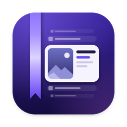

<p align="center"></p>

<h1 align="center">Biblo</h1>

<p align="center"><b>¿Qué quieres encontrar?</b><br>
Busca en los archivos de tu Mac por lo que muestran, dicen o suenan, con
<a href="https://huggingface.co/google/embeddinggemma-2">EmbeddingGemma 2</a> y sin que nada salga del Mac.</p>

<p align="center">App nativa de macOS · Apple Silicon, macOS 14 o posterior · Código abierto (MIT)</p>

Biblo lee las carpetas que eliges (fotos, capturas, PDF, documentos, presentaciones, audio, vídeo y, si quieres,
código) y te deja buscar en ellas describiendo lo que recuerdas, con tus palabras y en cualquier idioma. Pulsa
⇧⌘Espacio desde cualquier app, escribe «un perro en la playa» o «dónde hablan del presupuesto», y Biblo abre cada
formato en su propia columna, ordenada por acierto, y te lleva a la página o al segundo exacto.

EmbeddingGemma 2, el modelo de embeddings multimodal que Google DeepMind publicó en octubre de 2026, pone texto,
imágenes, audio y vídeo en un mismo espacio de significado: la foto de un perro en la playa queda junto a las palabras
«un perro en la playa», y una grabación en la que alguien habla del sueño, junto a «donde hablan de dormir». Entiende
más de 100 idiomas, es abierto (Apache 2.0) y, con 740 M de parámetros, cabe de sobra en un portátil.

## Qué puedes encontrar

- «una cebra en un vídeo» abre el clip en el momento en que aparece la cebra
- «donde hablan de dormir» salta a ese minuto del pódcast
- «lo que dijeron del presupuesto en la llamada» salta a la frase de la grabación en la que se dice, y la muestra
  escrita
- «la cláusula de las mascotas en el contrato» muestra la página del PDF con las palabras marcadas
- «un perro en la playa» encuentra la foto, y «error de pago rechazado», la captura
- una búsqueda en español encuentra una nota escrita en inglés, en árabe o en cualquiera de los más de 100 idiomas del
  modelo, y al revés
- «code: reintentar una llamada fallida con espera» encuentra la función en tus proyectos, si activas la búsqueda de
  código

Las palabras exactas también cuentan. Números de factura, códigos de error y nombres se buscan tal cual, en el nombre
del archivo, en el texto de los documentos y en el texto de las capturas, así que una búsqueda acierta por el
significado y por la cadena exacta a la vez.

## Cómo se ve

- **El panel** (⇧⌘Espacio): una columna por formato (capturas, imágenes, documentos, vídeo y audio), cada una
  ordenada por probabilidad de acierto; una búsqueda que empieza por `code:` muestra solo código. El resultado en el
  que estás crece al recorrer la columna, y una cinta violeta, como la de un libro, marca qué ha encontrado Biblo y
  con cuánta seguridad.
- **La ventana grande** (el icono del Dock, o ⌘O desde el panel): la misma búsqueda con rejilla de imágenes, filtros
  por formato y una vista previa al lado.
- **La barra de menús**: cómo va el indexado, pausarlo y abrir los ajustes.

Los violetas de Microsoft Foundry, sobre un degradado suave. El sistema de diseño está en [DESIGN.md](DESIGN.md) y la
visión de producto, en [PRODUCT.md](PRODUCT.md).

## Teclado

| Tecla | Qué hace |
|---|---|
| ⇧⌘Espacio | Abre el panel desde cualquier app (se cambia en Settings → General) |
| ↓ ↑ | Recorren la columna de un formato |
| ⇥ ⇧⇥ · ⌘1…⌘5 | Cambian de formato (también ← →, una vez en los resultados) |
| ↩ | Abre el resultado: vídeo y audio en su momento, un PDF con tus palabras en la búsqueda de Vista Previa, el código en tu editor, en la línea |
| Espacio · ⌘Y | Vista rápida, en la página o el momento (cuando ya estás en los resultados) |
| ⌘↩ | Lo muestra en el Finder |
| ⌘C | Copia el archivo, para pegarlo donde quieras |
| ⌘O | Pasa la búsqueda a la ventana grande |
| Esc | Cierra la vista rápida o el panel |

La primera vez que un vídeo se abre en su momento, macOS pregunta si Biblo puede controlar QuickTime Player: así salta
hasta allí.

## Privado

Nada de lo que indexas sale del Mac. Biblo solo se conecta a internet una vez, para descargar el modelo de Hugging
Face. Para transcribir, macOS descarga de Apple el modelo de voz de cada idioma que le falte, también una sola vez y
para todas las apps; la transcripción ocurre en el Mac. Sin cuenta, sin telemetría y sin comprobar actualizaciones. Solo lee tus archivos: nunca los cambia, los mueve ni
los sube.

## Qué lee

Solo las carpetas que eliges:

- imágenes y capturas (HEIC, JPEG, PNG, RAW, WebP y más), por lo que muestran; las capturas, también por su texto
- PDF página a página, escaneados incluidos. De uno largo lee enseguida las 30 primeras páginas y el resto cuando ha
  terminado con lo demás (hasta 5.000 páginas por archivo)
- documentos y presentaciones: txt, md, rtf, doc, docx, odt, pptx y html, los largos de la misma manera. El texto que
  es casi todo números, como una exportación de datos, solo se busca por su texto exacto
- audio de cualquier duración: el modelo escucha 30 segundos cada vez, así que Biblo toma ventanas de 30 s solapadas y
  cada acierto apunta a su momento. En macOS 26 también lee lo que se dice: el reconocimiento de voz de Apple lo
  transcribe en el Mac, frase a frase y con su segundo (hasta 4 horas por archivo), y una búsqueda encuentra el momento
  en que alguien dice algo, por el significado o por las palabras exactas
- vídeo de cualquier duración: un fotograma cada pocos segundos, uno por plano, más la pista de sonido y lo que se dice
  en ella, como el audio

Fuera de las carpetas que eliges para la búsqueda de código no lee código, y dentro de un proyecto (una carpeta con
`.git`, `package.json` y similares) solo lee las capturas. Nunca lee claves, certificados, archivos de contraseñas,
carpetas ocultas como `~/.ssh`, paquetes de apps, cachés ni los archivos temporales de Office (`~$…`). Se salta las
carpetas que parecen datasets y nunca descarga archivos que solo están en la nube (iCloud, OneDrive y otros proveedores
de archivos): para que entren, márcalos para tenerlos siempre en el Mac. En Settings → Folders puedes saltarte más
carpetas o tipos de archivo.

Lo que crea GitHub Copilot entra aunque no elijas su carpeta. La app y la CLI de Copilot guardan su trabajo en
`~/.copilot`, una carpeta oculta que Spotlight tampoco indexa, y de ella Biblo solo lee las presentaciones, los
documentos y los PDF (pptx, docx, doc, odt, rtf y pdf) de `session-state` y `chats`. También los de un proyecto que
Copilot montó para hacerlos, salvo que tenga más de 30: entonces son datos de prueba, como un corpus o una licencia en
40 idiomas, y no lo que hiciste. Se apaga en Settings → Folders → Documents made with GitHub Copilot.

El primer pase tarda unos minutos con unos cientos de archivos y puede llegar a una hora con una carpeta de Descargas
grande. Ocurre una sola vez, también con batería salvo que le pidas esperar al cargador, y se pausa en modo de bajo
consumo. Después, un archivo nuevo se puede buscar uno o dos segundos después de llegar.

## Código

EmbeddingGemma 2 también lee código, así que Biblo puede buscar en tus proyectos. Está apagado hasta que lo activas,
en Settings → Code o durante la bienvenida, para las carpetas que elijas. Cada repositorio muestra cuánto tarda en
leerse y cuánto ocupa su índice. Después empieza la búsqueda con `code:` y di qué hace el código, o escribe un nombre
que aparezca en él:

- «code: reintentar una llamada fallida con espera» encuentra la función, se llame como se llame
- «code: refreshAccessToken» va a la línea que la define, no a las que la llaman
- «code: dibujar cuántos ejemplos hay de cada clase» encuentra la celda del notebook

Los resultados se abren en tu editor, en la línea: Zed, VS Code, Cursor, Xcode, Sublime Text, los IDE de JetBrains y
algunos más (se elige en Settings). El código tiene su propio índice y nunca aparece en las demás búsquedas. Biblo lee
el código fuente, los notebooks (sin sus salidas) y la documentación del propio repositorio, y se salta lo que git
ignora, el código vendorizado o generado, los archivos de datos y todo lo que parezca una clave o una contraseña.
Mientras trabajas, el índice se pone al día un minuto después de que todo se calme.

## Modo demo

Para grabar Biblo o enseñarlo sin abrir tus carpetas: Settings → General → Demo mode. Biblo copia unos 155 archivos de
muestra a `~/Biblo Demo` y busca solo en ellos, con un índice aparte; al apagarlo vuelve a tus carpetas y a tu índice.
Cuentan unas semanas de Lucía Romero, responsable de atención al cliente de Contoso Outdoor, una marca ficticia de
material de montaña: el lanzamiento de una tienda de campaña, un asistente piloto hecho con Microsoft Foundry, un
offsite en Lisboa y un evento para 900 personas. Hay documentos, diapositivas, fotos, capturas, notas de voz, llamadas,
podcasts, vídeos y código, con datos públicos de Microsoft Foundry, Fabric y Copilot, empresas ficticias y cifras
inventadas. En macOS 26, lo que se dice en las grabaciones también se encuentra, en su segundo exacto: prueba «el código
de la taquilla» o «qué es RAG».

En git solo están los textos y el código escritos a mano, en `Resources/Demo.noindex`: las condiciones de uso de los
logos de Microsoft y GitHub y las de las voces limitan volver a publicar el resto. Lo genera `scripts/make-demo.sh`, que
necesita ffmpeg, Edge o Chrome, unas voces y los logos oficiales (se descargan como indica
`scripts/demo/assets/SOURCES.md`), y `./build.sh` lo mete en la app. Por defecto habla con las voces de macOS (si falta
alguna, dice cuál y dónde descargarla), pero su licencia solo permite un uso personal y no comercial: si vas a enseñar
la demo en público, en redes o en una charla, genera el audio y el vídeo con las voces neuronales de Azure AI Speech,
con la clave y la región de cualquier recurso de Speech o de AI Services:

```sh
BIBLO_TTS=azure AZURE_SPEECH_KEY=… AZURE_SPEECH_REGION=westeurope \
  scripts/make-demo.sh audio videos more_audio more_videos
```

Cuesta menos de un dólar, y cada frase se guarda en `~/.cache/biblo-demo-tts`, así que sale igual cada vez. Sean de
macOS o de Azure, las voces son sintéticas: dilo al publicar. Los logos aparecen sin alterar, como piden sus guías de marca:
revísalas antes de publicar nada.

## Instalar

Aún no hay versiones publicadas, así que Biblo se compila desde el código. Necesitas un Mac con Apple Silicon y
macOS 14 o posterior (se prueba en macOS 26), Xcode 26, git y CMake (o `uv`) para llama.cpp. Si `xcode-select -p`
muestra las Command Line Tools, cambia antes a Xcode (`sudo xcode-select -s /Applications/Xcode.app`) o antepón
`DEVELOPER_DIR=/Applications/Xcode.app/Contents/Developer` a cada orden: a las Command Line Tools les faltan las
macros de SwiftUI y de Swift Testing que necesita la compilación.

```sh
git clone https://github.com/jrubiosainz/Biblo && cd Biblo
scripts/build-llama.sh            # llama.cpp en una versión fija, con un parche de una línea (unos minutos)
swift build -c release && swift test
./build.sh                        # → build.noindex/Biblo.app
scripts/install.sh                # la copia en /Applications y la abre
```

La primera vez, mientras se descarga el modelo (865 MB, una sola vez), elige las carpetas en las que buscar: enteras
o solo algunas de sus subcarpetas. Biblo calcula cuánto tardará el primer pase en cada una. Después pulsa
**⇧⌘Espacio** en cualquier app y describe lo que buscas.

Tras cada cambio, repite `./build.sh` y `scripts/install.sh`. Con un Developer ID, `scripts/release.sh` firma,
notariza y empaqueta un DMG.

## Desarrollo

- `scripts/dev-run.sh` abre una compilación de prueba con su propio índice, modelos y ajustes en `.dev/`, sin tocar la
  app instalada. Busca en `~/BibloTestbed`, una carpeta de archivos de prueba que crea `scripts/make-testbed.sh`
  (necesita ffmpeg).
- `.build/release/biblo` es la herramienta de terminal: indexa, busca y pasa los evals (`biblo --help`). En `evals/`
  están las consultas con las que se mide cualquier cambio en el orden de los resultados.
- `swift test` pasa las pruebas. Las que comparan con vectores de referencia guardados necesitan el modelo y se saltan
  sin él: `BIBLO_MODELS=<carpeta con los GGUF> swift test`.

## Cómo funciona

```
tus carpetas ─► lectores (ImageIO, PDFKit, AVFoundation, Vision para el texto de las capturas y SpeechAnalyzer
                para lo que se dice en audio y vídeo)
             ─► EmbeddingGemma 2 sobre llama.cpp (Metal), en un proceso auxiliar que se cierra al terminar
             ─► un único archivo SQLite: un vector por imagen, página, pasaje, fotograma, 30 s de sonido y frase
                dicha, más un índice de palabras (la búsqueda de código guarda otro, para el código)
tus palabras ─► la parte de texto del mismo modelo (~250 MB, solo mientras buscas)
             ─► los vectores más cercanos + las palabras exactas
```

Biblo ejecuta la versión de 8 bits de EmbeddingGemma 2 de ggml-org con
[llama.cpp](https://github.com/ggml-org/llama.cpp), en la GPU del Mac. Todos los vectores viven en el mismo espacio de
768 dimensiones, y por eso una sola consulta puede comparar un fotograma con una página de un PDF. Cada búsqueda
convierte tus palabras en un vector y lo compara con todo el índice; las coincidencias literales suben, porque ningún
embedding guarda exacto un número de factura.

El índice recuerda qué versión del modelo hizo sus vectores. Una actualización que no los cambia conserva tu índice, y
una prueba compara cada actualización de llama.cpp con vectores de referencia guardados.

Es nativa (Swift, AppKit y SwiftUI) y no Electron, para que la arquitectura no lastre el Mac: un panel mínimo medido en
el Mac de desarrollo ocupa 17 MB en un proceso con SwiftUI, frente a 51 MB con WKWebView y 102 MB con Electron, en
cuatro procesos cada uno.

## Preguntas

**¿En qué se diferencia de Spotlight?** Spotlight encuentra archivos por su nombre, su texto y sus metadatos. Biblo
también los encuentra por lo que muestran o dicen, y te lleva a la página o al momento. Conviven sin problema.

**¿Por qué descarga 865 MB?** Es el modelo: la parte de texto (310 MB) y los codificadores de imagen y audio (555 MB).
La app ocupa unos 60 MB, y más de la mitad son los archivos del modo demo (33 MB).

**¿Ralentiza el Mac?** Solo pesa el primer pase; después lee únicamente lo nuevo. El modelo corre en un proceso aparte
que se cierra al terminar, y la parte de búsqueda solo se carga mientras buscas.

**¿Qué idiomas?** El modelo conoce más de 100 y Biblo busca en todos, también de uno a otro. Los evals del repositorio
solo cubren inglés, bengalí y árabe, y Google advierte que el modelo no rinde igual en todos los idiomas. Hay dos
límites que afectan a las palabras exactas, no al significado: dentro de las capturas las lee el reconocimiento de
texto de Apple, que conoce unos 25 idiomas, y los idiomas que se escriben sin espacios, como el chino, el japonés o el
tailandés, no se dividen en palabras. Lo que se dice en audio y vídeo se transcribe en el idioma en que se habla, si
es uno de los tres primeros idiomas del Mac, el inglés u otro cuyo modelo de voz ya tenga el Mac.

**¿Por qué no encuentra un archivo?** Comprueba que está en una de tus carpetas, que está descargado en el Mac y que no
está dentro de un proyecto de código, donde solo cuentan las capturas. Un archivo cifrado, con una etiqueta de
confidencialidad (Microsoft Purview) o una contraseña, no se puede leer: Biblo lo encuentra solo por su nombre.

**¿Cómo lo quito?** Ciérralo y borra `Biblo.app`, `~/Library/Application Support/Biblo` (el modelo y los índices) y
`~/Library/Preferences/com.jrubiosainz.Biblo.plist` (los ajustes).

## Créditos

Biblo se apoya en [EmbeddingGemma 2](https://huggingface.co/google/embeddinggemma-2) de Google DeepMind (Apache 2.0),
[llama.cpp](https://github.com/ggml-org/llama.cpp) (MIT) y [Sparkle](https://sparkle-project.org) (MIT), y su motor
parte de código de Abdur Rahim publicado con licencia MIT. Sus avisos de licencia van dentro de la app, en
`Biblo.app/Contents/Resources/Acknowledgements.txt`.

Biblo es un proyecto personal: no es un producto de Google, Apple, Microsoft ni GitHub. Gemma es una marca de Google
LLC; Mac, Spotlight y Quick Look son marcas de Apple Inc.; Microsoft, Foundry, Fabric y Copilot son marcas de
Microsoft Corporation, y GitHub es una marca de GitHub, Inc.

## Licencia

MIT. Consulta [LICENSE](LICENSE).
